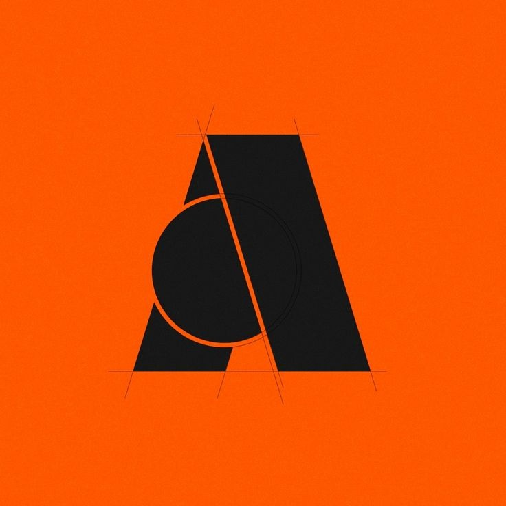

# AMBIENT STUDIO 🕹️🦆

> **The Silly Indie Game Lab.** We build chaotic, high-charm physics games with tactile joy, bespoke audio synthesis, and zero unnecessary fluff.



---

## 🎮 Explore The Studio

- **[index.html](index.html)**: The official landing page with studio philosophy, featured games, and portal hubs.
- **[games.html](games.html)**: The complete games catalogue featuring live search, genre filters (`Arcade`, `Food`, `Cozy`, `Physics`), and audio engines.
- **[soundboard.html](soundboard.html)**: The dedicated Bleep-Bloop Acoustic Lab featuring 7 real-time Web Audio API synthesizers, custom waveform sculpting, and live 60 FPS oscilloscope.
- **[button.html](button.html)**: The dedicated Emergency Silly Button procrastination chamber with tactile sound modes, score progression, and achievement trophies.

---

## 🕹️ Featured Games Roster

| Game | Genre | Highlight |
|---|---|---|
| **Duck Drift: Bread Heist** | Physics / Arcade | Turbo drifting duck dodging bread crumbs & traffic cone chaos. |
| **Quantum Toast 3000** | High-Velocity Food | Superheated butter trajectories, knife dodges, and supersonic bagel physics. |
| **Capybara Zero-G: Melon Drifter** | Cozy / Space Drift | Newton's laws meet maximum relaxation among zero-G floating watermelons. |
| **Lawnmower Revenge** | Chaos Physics | High-RPM mechanical rampage reclaiming suburban backyards. |

---

## ⚡ Interactive Engine Features

- **Integrated Retro Arcade Cabinet**: Built directly on HTML5 Canvas (60 FPS) with custom particle physics, hit recovery, score popups, and three playable mini-games.
- **Web Audio API Chiptune & FX Synthesizer**: Pure oscillator FM synthesis producing duck quacks, spring boings, laser blasts, engine revs, and retro fanfares without external audio files.
- **Instant Offline Demo Generator**: Download standalone, single-file runnable HTML game builds straight from the browser.
- **VIP Playtest Squad Pass Generator**: Dynamic encrypted access token issuer with instant clipboard sharing.
- **Steam Wishlist Integration**: Interactive hype counter with confetti physics.

---

## 🛠️ Tech Stack

- **Core**: Semantic HTML5, Vanilla JavaScript (ES6+)
- **Audio**: Web Audio API (Bespoke FM synthesis, biquad filtering, gain envelopes)
- **Graphics**: HTML5 Canvas 2D engine (60 FPS physics loops)
- **Styling**: Vanilla CSS3 (Custom design system, molten dark theme, zero UI slop)

---

## 🚀 Running Locally

You can run the studio locally using any static web server:

```bash
# Python 3
python -m http.server 8000

# Node.js (npx)
npx serve .
```

Open `http://localhost:8000` in your favorite browser and enjoy!
